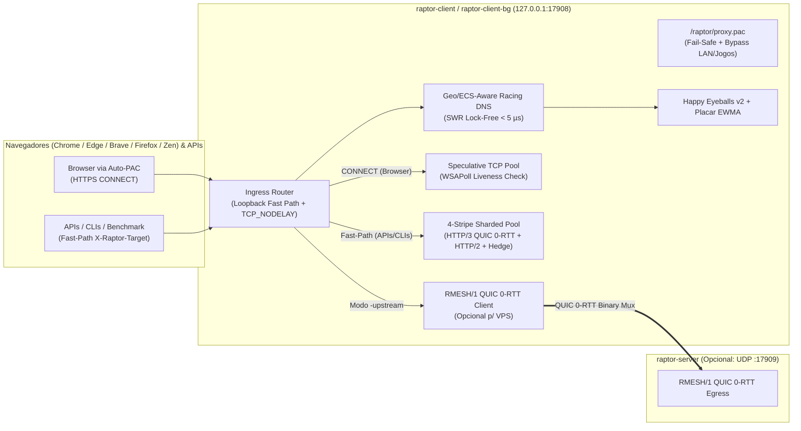

# Raptor-Mesh (`RMESH/1`)

[](https://go.dev/)
[](#execucao-nativa-e-silenciosa-no-windows-sem-admin)
[](#arquitetura)
[](LICENSE)

**Raptor-Mesh** é um acelerador de rede local de baixíssima latência e protocolo de transporte binário (**`RMESH/1`** sobre **QUIC 0-RTT**) escrito em **Go**, projetado para rodar nativamente no Windows (~30 MB de RAM, sem janela preta e sem precisar de VPS ou privilégios de Administrador) escutando em **`127.0.0.1:17908`**.

Ele reúne em um único projeto open-source otimizações que normalmente exigiriam combinar múltiplas ferramentas separadas (como *SmartDNS + proxy local + túnel QUIC + tuning Winsock2*):

- **Geo/ECS-Aware Racing DNS + Cache Lock-Free SWR (`< 5 µs`)** — corre em paralelo contra `1.1.1.1`, `8.8.8.8`, `9.9.9.9` e `1.0.0.1` para APIs/domínios globais, mas prioriza automaticamente o **DNS do seu provedor (`isp-geo`) + ECS (`8.8.8.8`/`8.8.4.4`)** para CDNs de mídia e streaming (Instagram/Meta FNA, YouTube GGC, Netflix OCA, Twitch, Akamai, etc.) para você nunca ser desviado para PoPs nos EUA.
- **Happy Eyeballs v2 Agressivo + Placar Preditivo EWMA** — dispara dials concorrentes (stagger de 15 ms) entre IPv4 e IPv6, fixa o IP campeão de menor RTT e faz *hedged dialing* automático para eliminar travamentos de 250–380 ms em rotas Anycast/IPv6 instáveis.
- **Speculative TCP Pre-Connect Pool com Checagem `ws2_32.dll!WSAPoll`** — mantém sockets TCP pré-conectados na porta 443 para seus sites favoritos e valida a saúde do socket em ~1 µs antes de entregá-lo ao navegador (zero sockets mortos `FIN`/`RST` e zero vazamento de conexões em domínios aleatórios).
- **4-Stripe Sharded HTTP/3 (QUIC 0-RTT) + HTTP/2 Multiplexado + Hedged Tail-Latency Racing** — para chamadas via Fast-Path (APIs, CLIs, automações e benchmark), mantém 4 stripes paralelos pré-aquecidos com auto-calibração H3 vs H2, cache compartilhado de tickets TLS 1.3 (4096 slots) e suporte a streaming SSE (`Flusher`).
- **Protocolo Binário Próprio `RMESH/1` sobre QUIC 0-RTT (`raptor-client` ↔ `raptor-server`)** — opcionalmente permite tunelar todo o tráfego em modo 2-hop sobre UDP/QUIC com 0-RTT Early Data (localmente ou apontado para uma VPS remota).
- **Tuning Nativo de Kernel Windows (Winsock2)** — ativa `TCP_FASTOPEN`, `SIO_LOOPBACK_FAST_PATH` e `TCP_NODELAY`, **preservando intacto o *TCP Receive Window Auto-Tuning* do Windows** nas conexões WAN para não limitar banda em links de fibra.
- **Fail-Safe Auto-PAC + Bypass Automático para Jogos/Anti-Cheat** — gera dinamicamente `http://127.0.0.1:17908/raptor/proxy.pac` retornando `PROXY 127.0.0.1:17908; DIRECT`. Se o serviço for fechado, o navegador volta automaticamente para conexão direta sem derrubar sua internet. Domínios de rede local e servidores de clientes de jogos (como Riot Games / Vanguard) vão direto (`DIRECT`) por padrão.

---

## Como o Raptor-Mesh se Compara a Projetos Existentes?

| Projeto | Foco Principal | Precisa de VPS externa? | DNS Geo/ECS + Happy Eyeballs EWMA | Speculative TCP Pool (`WSAPoll`) | Auto-Instalação Windows Sem Admin + PAC Fail-Safe |
|---|---|:---:|:---:|:---:|:---:|
| **Clash (Mihomo) / sing-box** | Roteador multi-protocolo (TUN/YAML/subscriptions) | Geralmente sim | Parcial / externo | Não | Não (requer GUI/TUN) |
| **Hysteria 2** | Túnel UDP/QUIC resistente a perda de pacotes | Sim | Não | Não | Não |
| **SmartDNS** | Apenas resolução DNS rápida | Não | Sim (DNS apenas) | Não | Serviço apenas |
| **Raptor-Mesh** | **Acelerador local Zero-VPS + túnel opcional `RMESH/1` QUIC 0-RTT** | **Não (opcional)** | **Sim (integrado)** | **Sim (integrado)** | **Sim (1 comando)** |

---

## Arquitetura



---

## Execução Nativa e Silenciosa no Windows (Sem Admin)

O diferencial prático do Raptor-Mesh no dia a dia é rodar **100% nativo no Windows**, sem precisar de Docker, WSL, drivers TUN ou janelas de terminal abertas:

### 1. Compilar (ou baixar o `.zip` em Releases)
Pré-requisito para compilar do código-fonte: [Go 1.25+](https://go.dev/dl/) (`winget install --id GoLang.Go --exact`).

```powershell
.\scripts\build.ps1
```

Isso executa os testes unitários (`go test ./...`) e gera 4 binários estáticos otimizados em `bin\`:
- `raptor-client-bg.exe` — binário **sem janela de console** (`-H=windowsgui`) para segundo plano;
- `raptor-client.exe` — versão de console para testes/debug;
- `raptor-server.exe` — servidor `RMESH/1` sobre UDP/QUIC 0-RTT;
- `raptor-bench.exe` — suíte de benchmark End-to-End concorrente.

### 2. Instalar Inicialização Automática (Task Scheduler + Auto-PAC Fail-Safe)
```powershell
.\scripts\install_autostart.ps1
```

O que esse único comando faz (sem pedir elevação de Administrador):
1. Registra a tarefa **`Raptor-Mesh`** no Agendador de Tarefas do Windows para iniciar `raptor-client-bg.exe` silenciosamente no seu logon (sem limite de 72h, ativo na bateria e com reinício automático em caso de falha).
2. Sobe o serviço imediatamente e aguarda `http://127.0.0.1:17908/raptor/health` responder `200 OK`.
3. Ativa o **Script de configuração automática (`AutoConfigURL`)** do Windows apontando para `http://127.0.0.1:17908/raptor/proxy.pac` e notifica o WinINet na hora — Chrome, Edge e Brave passam a usar o Raptor-Mesh imediatamente sem reiniciar o PC.
   - *No Firefox / Zen Browser:* basta garantir que **Configurações → Configurações de rede → "Usar as configurações de proxy do sistema"** esteja marcado.

### 3. Monitorar ou Desinstalar Limpamente
```powershell
# Ver status da tarefa, PID, RAM, DNS Geo/ECS e hits do pool TCP ao vivo
.\scripts\status_raptor.ps1

# Painel JSON completo no navegador
# http://127.0.0.1:17908/raptor/stats

# Remover tarefa do Windows e restaurar proxy padrão em 1 segundo
.\scripts\uninstall_autostart.ps1
```

---

## Totalmente Customizável (`config/targets.json`)

Você controla exatamente quais sites e APIs ficam pré-aquecidos editando [config/targets.json](config/targets.json):

```json
{
  "listen_addr": "127.0.0.1:17908",
  "server_addr": "127.0.0.1:17909",
  "dns_resolvers": ["1.1.1.1:53", "8.8.8.8:53", "9.9.9.9:53", "1.0.0.1:53"],
  "prewarm_interval_sec": 12,
  "speculative_tcp_pool_size": 3,
  "targets": [
    {
      "host": "api.openai.com",
      "port": 443,
      "warm_path": "/",
      "warm_method": "HEAD",
      "prefer_h3": true
    },
    {
      "host": "www.youtube.com",
      "port": 443,
      "tcp_only": true
    }
  ]
}
```

### Entendendo os dois modos de alvo:
- **Alvos de Navegador (`"tcp_only": true`) — Recomendado para seus 15–25 sites favoritos:**
  - Mantém **DNS Geo/ECS SWR + IP Campeão EWMA + 1 socket TCP especulativo verificado via `WSAPoll`**.
  - **Não envia** sondas HTTP `HEAD /` periódicas em segundo plano — zero risco de disparar anti-bot/Cloudflare/rate-limit e consumo mínimo de rede (seguro inclusive durante jogos online).
- **Alvos de API / Fast-Path (`"tcp_only": false`):**
  - Além de DNS + TCP Pool, calibra e mantém 4 stripes quentes de **HTTP/3 (QUIC 0-RTT)** e **HTTP/2** prontos para receber requisições imediatas com 0 ms de handshake via cabeçalho `X-Raptor-Target`.

Após editar `config/targets.json`, aplique reiniciando a tarefa:
```powershell
Stop-ScheduledTask "Raptor-Mesh"; Start-ScheduledTask "Raptor-Mesh"
```

---

## Modo Cliente ↔ Servidor Remoto (`RMESH/1` QUIC 0-RTT)

Se você quiser usar o protocolo binário `RMESH/1` através de uma VPS própria:

```powershell
# No servidor (VPS Linux ou Windows — libere UDP/17909 no firewall)
./raptor-server -listen 0.0.0.0:17909

# No seu PC Windows (modo console)
.\bin\raptor-client.exe -listen 127.0.0.1:17908 -upstream SEU_IP_VPS:17909 -tunnel-conns 4

# Ou registrando direto no Agendador de Tarefas
.\scripts\install_autostart.ps1 -Upstream SEU_IP_VPS:17909
```

---

## Benchmark End-to-End Integrado (`:7897` vs `:17908`)

O projeto inclui um benchmark concorrente nativo que dispara rajadas simultâneas **100% vivas contra os servidores reais (zero cache de resposta HTTP)** comparando um proxy tradicional na porta `7897` (detecta automaticamente o Clash se estiver rodando; caso contrário, sobe um proxy baseline honesto em `:7897` sem atrasos artificiais) contra o Raptor-Mesh na porta `17908`:

```powershell
# Benchmark no modo Direct Edge Accelerator
.\scripts\run_benchmark.ps1 -Concurrency 6 -Rounds 3

# Benchmark no modo 2-Hop completo (raptor-client :17908 <-> RMESH/1 QUIC 0-RTT <-> raptor-server :17909)
.\scripts\run_benchmark.ps1 -MeshRelay -Concurrency 6 -Rounds 3
```

### Nota Técnica Honesta sobre Navegador (`CONNECT`) vs Fast-Path
- **No modo Fast-Path (`X-Raptor-Target` / APIs / CLIs / benchmark):** o Raptor-Mesh reaproveita seu pool multiplexado 4-stripe **HTTP/3 (QUIC 0-RTT) + HTTP/2** já autenticado, entregando reduções reais típicas de **2x a >5x** (cortando DNS + TCP + TLS para 1 RTT puro até o PoP mais próximo).
- **No navegador comum via proxy HTTPS `CONNECT`:** o TLS é negociado ponta-a-ponta entre o navegador e o site (garantindo privacidade total e zero avisos de certificado). Nesse modo, o Raptor-Mesh acelera via **DNS Geo/ECS SWR (`< 5 µs`) + Happy Eyeballs v2 EWMA (evitando stalls IPv6 de 250–380 ms) + Speculative TCP Pool (`WSAPoll`) + `TCP_FASTOPEN`**.

---

## Estrutura do Repositório

```text
├── cmd/
│   ├── raptor-client/          # Edge proxy local (127.0.0.1:17908)
│   ├── raptor-server/          # Servidor RMESH/1 sobre QUIC 0-RTT (UDP :17909)
│   └── raptor-bench/           # Benchmark E2E concorrente (:7897 vs :17908)
├── config/
│   └── targets.json            # Lista customizável de domínios prioritários
├── internal/
│   ├── config/                 # Carregamento de configuração
│   ├── dns/                    # Geo/ECS-Aware Racing DNS + Cache SWR + testes
│   ├── prewarmer/              # Daemon preditivo + limpeza periódica 24/7
│   ├── protocol/               # Wire protocol RMESH/1 + Ed25519 TLS + testes
│   ├── proxy/                  # Ingress HTTP/CONNECT/PAC/SSE + baseline proxy
│   └── transport/              # H3/H2 4-stripe, Happy Eyeballs, TCP Pool, QUIC, Winsock2
└── scripts/
    ├── build.ps1               # Testes + compilação (incluindo -H=windowsgui)
    ├── install_autostart.ps1   # Instalação 1-comando (Task Scheduler + Auto-PAC)
    ├── uninstall_autostart.ps1 # Remoção limpa + restauração do proxy do Windows
    ├── status_raptor.ps1       # Telemetria ao vivo no terminal
    └── run_benchmark.ps1       # Runner automatizado do benchmark E2E
```

## Licença

Distribuído sob a licença **MIT**. Veja [LICENSE](LICENSE) para mais detalhes.
