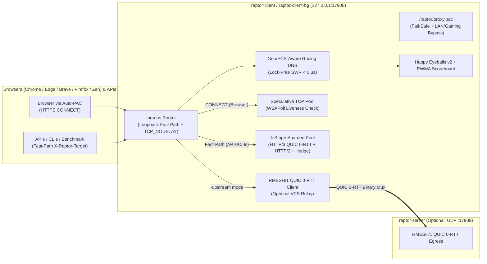

# Raptor-Mesh (`RMESH/1`)

<p align="left">
  <strong>English</strong> | <a href="README.pt-BR.md">Português (Brasil)</a>
</p>

[](https://go.dev/)
[](#native-silent-windows-execution-no-admin-required)
[](#architecture)
[](LICENSE)

**Raptor-Mesh** is an ultra-low-latency local network accelerator and custom binary transport protocol (**`RMESH/1`** over **QUIC 0-RTT**) written in **Go**, designed to run natively on Windows (~30 MB RAM, zero console window, no VPS or Administrator privileges required) listening on **`127.0.0.1:17908`**.

It unifies in a single open-source codebase optimizations that typically require stitching multiple tools together (*SmartDNS + local proxy + QUIC tunnel + Winsock2 kernel tuning*):

- **Geo/ECS-Aware Racing DNS + Lock-Free SWR Cache (`< 5 µs`)** — races `1.1.1.1`, `8.8.8.8`, `9.9.9.9`, and `1.0.0.1` in parallel for global APIs/domains, while automatically prioritizing your **ISP DNS (`isp-geo`) + ECS-capable resolvers (`8.8.8.8`/`8.8.4.4`)** for media and streaming CDNs (Meta/Instagram FNA, YouTube GGC, Netflix OCA, Twitch, Akamai, etc.) so media traffic always hits local ISP edge caches instead of distant POPs.
- **Aggressive Happy Eyeballs v2 + Predictive EWMA Route Scoreboard** — launches parallel IPv4/IPv6 dials (15 ms stagger), pins the lowest-RTT champion IP, and performs adaptive hedged dialing to eliminate 250–380 ms IPv6/Anycast stalls.
- **Speculative TCP Pre-Connect Pool with `ws2_32.dll!WSAPoll` Liveness Checks** — keeps fresh TCP sockets pre-connected on port 443 for your favorite sites and verifies socket health in ~1 µs before handing them to the browser (zero dead `FIN`/`RST` sockets and zero socket leaks on one-off domains).
- **4-Stripe Sharded HTTP/3 (QUIC 0-RTT) + HTTP/2 Multiplexing + Hedged Tail-Latency Racing** — for Fast-Path calls (APIs, CLIs, automation, and benchmarks), maintains 4 pre-warmed parallel transport stripes with live H3 vs H2 auto-calibration, a shared 4096-entry TLS 1.3 session ticket cache, and SSE (`Flusher`) streaming support.
- **Custom Binary `RMESH/1` Protocol over QUIC 0-RTT (`raptor-client` ↔ `raptor-server`)** — optionally tunnels traffic in 2-hop mode over UDP/QUIC with 0-RTT Early Data (locally or to a remote VPS).
- **Native Windows Kernel Hygiene (Winsock2)** — enables `TCP_FASTOPEN`, `SIO_LOOPBACK_FAST_PATH`, and `TCP_NODELAY`, while **preserving Windows TCP Receive Window Auto-Tuning** on WAN sockets so high-speed fiber downloads are never capped.
- **Fail-Safe Auto-PAC + Automatic Gaming/Anti-Cheat Bypass** — dynamically serves `http://127.0.0.1:17908/raptor/proxy.pac` returning `PROXY 127.0.0.1:17908; DIRECT`. If the daemon ever stops, browsers automatically fall back to `DIRECT` without breaking your internet connection. Local LAN subnets and game client/anti-cheat domains (e.g. Riot Games / Vanguard) automatically bypass to `DIRECT`.

---

## How Does Raptor-Mesh Compare to Existing Projects?

| Project | Primary Focus | Requires Remote VPS? | Geo/ECS DNS + Happy Eyeballs EWMA | Speculative TCP Pool (`WSAPoll`) | Zero-Admin Windows Autostart + Fail-Safe PAC |
|---|---|:---:|:---:|:---:|:---:|
| **Clash (Mihomo) / sing-box** | Multi-protocol proxy router (TUN/YAML/subscriptions) | Usually yes | Partial / external | No | No (requires GUI/TUN) |
| **Hysteria 2** | Loss-resilient UDP/QUIC tunnel | Yes | No | No | No |
| **SmartDNS** | Fast local DNS resolution only | No | Yes (DNS only) | No | Service only |
| **Raptor-Mesh** | **Zero-VPS local edge accelerator + optional `RMESH/1` QUIC 0-RTT tunnel** | **No (optional)** | **Yes (built-in)** | **Yes (built-in)** | **Yes (1 command)** |

---

## Architecture



---

## Native Silent Windows Execution (No Admin Required)

A core practical advantage of Raptor-Mesh is running **100% natively on Windows** with no Docker, no WSL, no TUN drivers, and no visible terminal windows:

### 1. Build from Source (or download the pre-built `.zip` from Releases)
Build requirement: [Go 1.25+](https://go.dev/dl/) (`winget install --id GoLang.Go --exact`).

```powershell
.\scripts\build.ps1
```

This runs all unit tests (`go test ./...`) and builds 4 optimized static binaries under `bin\`:
- `raptor-client-bg.exe` — **windowless** background binary (`-H=windowsgui`);
- `raptor-client.exe` — console version for testing and debugging;
- `raptor-server.exe` — `RMESH/1` UDP/QUIC 0-RTT server;
- `raptor-bench.exe` — concurrent End-to-End latency benchmark suite.

### 2. Install Automatic Startup (Task Scheduler + Fail-Safe Auto-PAC)
```powershell
.\scripts\install_autostart.ps1
```

This single command (requiring **no Administrator rights**):
1. Registers the **`Raptor-Mesh`** Windows Scheduled Task to start `raptor-client-bg.exe` silently at logon (no 72-hour timeout, battery-safe, automatic restart on failure).
2. Starts the service immediately and verifies `http://127.0.0.1:17908/raptor/health` returns `200 OK`.
3. Configures Windows **Automatic proxy setup (`AutoConfigURL`)** to `http://127.0.0.1:17908/raptor/proxy.pac` and refreshes WinINet immediately — Chrome, Edge, and Brave pick it up right away without rebooting.
   - *Firefox / Zen Browser:* verify **Settings → Network Settings → "Use system proxy settings"** is selected.

### 3. Monitor or Cleanly Uninstall
```powershell
# Live task status, PID, RAM usage, Geo/ECS DNS stats, and TCP pool hit ratio
.\scripts\status_raptor.ps1

# Full JSON telemetry endpoint in your browser
# http://127.0.0.1:17908/raptor/stats

# Unregister task, stop daemon, and restore default Windows proxy settings
.\scripts\uninstall_autostart.ps1
```

---

## Fully Customizable (`config/targets.json`)

Tailor pre-warming to your daily browsing or API stack by editing [config/targets.json](config/targets.json):

```json
{
  "listen_addr": "127.0.0.1:17908",
  "server_addr": "127.0.0.1:17909",
  "dns_resolvers": ["1.1.1.1:53", "8.8.8.8:53", "9.9.9.9:53", "1.0.0.1:53"],
  "prewarm_interval_sec": 12,
  "speculative_tcp_pool_size": 3,
  "targets": [
    {
      "host": "api.openai.com",
      "port": 443,
      "warm_path": "/",
      "warm_method": "HEAD",
      "prefer_h3": true
    },
    {
      "host": "www.youtube.com",
      "port": 443,
      "tcp_only": true
    }
  ]
}
```

### Target Modes
- **Browser Targets (`"tcp_only": true`) — Recommended for your top 15–25 daily websites:**
  - Keeps **Geo/ECS SWR DNS + EWMA Champion IP + 1 verified-alive speculative TCP socket (`WSAPoll`)** ready.
  - Sends **zero** background HTTP `HEAD /` probes — preventing anti-bot/Cloudflare/rate-limit triggers and keeping background network noise near zero (safe during competitive online gaming).
- **API / Fast-Path Targets (`"tcp_only": false`):**
  - Additionally calibrates and maintains 4 warm **HTTP/3 (QUIC 0-RTT)** and **HTTP/2** stripes ready for zero-handshake requests via the `X-Raptor-Target` header.

After editing `config/targets.json`, reload the background task:
```powershell
Stop-ScheduledTask "Raptor-Mesh"; Start-ScheduledTask "Raptor-Mesh"
```

---

## Remote Client ↔ Server Mode (`RMESH/1` over QUIC 0-RTT)

To tunnel traffic through your own remote VPS using the `RMESH/1` binary protocol:

```powershell
# On your VPS (Linux or Windows — open UDP/17909 on firewall)
./raptor-server -listen 0.0.0.0:17909

# On your local Windows machine (console mode)
.\bin\raptor-client.exe -listen 127.0.0.1:17908 -upstream YOUR_VPS_IP:17909 -tunnel-conns 4

# Or install directly into Task Scheduler pointing to your VPS
.\scripts\install_autostart.ps1 -Upstream YOUR_VPS_IP:17909
```

---

## Built-in End-to-End Benchmark (`:7897` vs `:17908`)

Raptor-Mesh ships with a concurrent End-to-End benchmark that sends **100% live upstream requests (zero HTTP response caching)** comparing a traditional proxy on port `7897` (auto-detects Clash if running, or spawns an honest, un-throttled baseline proxy on `:7897`) against Raptor-Mesh on port `17908`:

```powershell
# Direct Edge Accelerator mode benchmark
.\scripts\run_benchmark.ps1 -Concurrency 6 -Rounds 3

# Full 2-Hop RMESH/1 QUIC 0-RTT relay benchmark (client :17908 <-> server :17909)
.\scripts\run_benchmark.ps1 -MeshRelay -Concurrency 6 -Rounds 3
```

### Honest Engineering Note: Browser `CONNECT` vs Fast-Path
- **Fast-Path Mode (`X-Raptor-Target` / APIs / CLIs / Benchmark):** reuses Raptor-Mesh's pre-warmed 4-stripe **HTTP/3 (QUIC 0-RTT) + HTTP/2** multiplexed pools, eliminating DNS + TCP + TLS handshakes down to a single physical RTT (typically **2x to >5x** real speedup).
- **Standard Browser HTTPS `CONNECT`:** TLS stays strictly end-to-end encrypted between your browser and each website (zero MITM, zero custom root CA warnings). In this mode, Raptor-Mesh accelerates browsing through **Geo/ECS SWR DNS (`< 5 µs`) + Happy Eyeballs v2 EWMA (eliminating 250–380 ms IPv6 stalls) + Speculative TCP Pool (`WSAPoll`) + `TCP_FASTOPEN`**.

---

## Repository Layout

```text
├── cmd/
│   ├── raptor-client/          # Local edge proxy (127.0.0.1:17908)
│   ├── raptor-server/          # RMESH/1 QUIC 0-RTT server (UDP :17909)
│   └── raptor-bench/           # Concurrent E2E benchmark (:7897 vs :17908)
├── config/
│   └── targets.json            # Customizable priority targets list
├── internal/
│   ├── config/                 # Configuration loader
│   ├── dns/                    # Geo/ECS-Aware Racing DNS + SWR Cache + tests
│   ├── prewarmer/              # Predictive pre-warmer + 24/7 cache pruning
│   ├── protocol/               # RMESH/1 binary wire framing + Ed25519 TLS + tests
│   ├── proxy/                  # HTTP/CONNECT/PAC/SSE ingress + baseline proxy
│   └── transport/              # 4-stripe H3/H2, Happy Eyeballs, TCP Pool, QUIC, Winsock2
└── scripts/
    ├── build.ps1               # Tests + build (including -H=windowsgui)
    ├── install_autostart.ps1   # 1-command Task Scheduler + Fail-Safe Auto-PAC setup
    ├── uninstall_autostart.ps1 # Clean teardown & Windows proxy restore
    ├── status_raptor.ps1       # Live CLI telemetry dashboard
    └── run_benchmark.ps1       # Automated E2E benchmark runner
```

## License

Released under the **MIT License**. See [LICENSE](LICENSE) for details.
